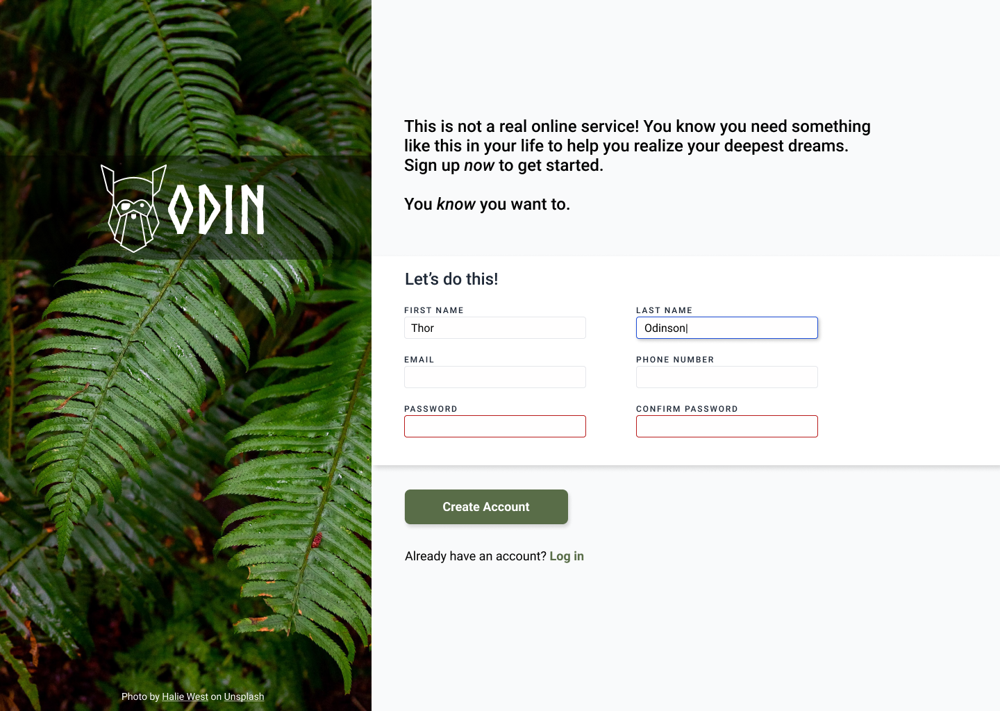

# Sign-Up Form

A responsive and accessible sign-up form interface built with modern semantic HTML5 and CSS. This project focuses on UI layout precision, client-side form controls, custom form validation states, and self-hosted variable font performance.

Part of [The Odin Project](https://www.theodinproject.com/paths/full-stack-javascript/courses/intermediate-html-and-css) (Intermediate HTML and CSS Course).

---

## 📸 Preview



> **Live Demo:** [View Live Site](https://janf1997-sys.github.io/odin-sign-up-form/)

---

## 🛠 Features & Learning Goals

- **Semantic Form Architecture:** Proper use of `<form>`, `<fieldset>`, `<label>`, `<input>`, and contextual helper text.
- **Client-Side Validation & Feedback:**
  - Standard HTML5 constraint validation (`required`, `pattern`, `type="email"`).
  - Custom visual states using `:valid`, `:invalid`, and `:focus-visible` pseudo-classes.
  - Interactive password confirmation check via JavaScript (`scripts.js`).
- **Typography & Asset Performance:**
  - Self-hosted Variable Fonts (`Roboto` and `Roboto Mono` via WOFF2) for optimized HTTP requests and zero external tracking.
  - Resource preloading (`<link rel="preload">`) implemented to reduce cumulative layout shifts (CLS) and initial render blocking.
- **Responsive Layout:** Two-panel desktop split view collapsing seamlessly into a stacked mobile layout via modern Flexbox/Grid mechanics.

---

## 📂 Project Structure

```text
odin-sign-up-form/
├── assets/
│   ├── fonts/
│   │   ├── Roboto-VariableFont_wdth_wght.woff2
│   │   └── RobotoMono-VariableFont_wght.woff2
│   ├── Background.jpg
│   ├── Default.svg
│   └── Template.png
├── index.html
├── styles.css
├── scripts.js
├── README.md
└── .gitignore
```

---

## 🚀 Tech Stack

- **HTML5:** Semantic markup, accessibility attributes, form validation constraints
- **CSS3:** Flexbox, CSS Grid, custom properties (CSS variables), modern typography (`@font-face` variable axes)
- **JavaScript (ES6+):** Password matching validation and dynamic DOM interaction
- **Tooling:** WSL2, VS Code, Git/GitHub

---

## ⚙️ Local Development

1. **Clone the repository:**

   ```bash
   git clone https://github.com/janf1997-sys/odin-sign-up-form.git
   cd odin-sign-up-form
   ```
2. **Run locally:**

   - Open the directory in VS Code.
   - Start with **Live Server** (`Go Live`) directly from the project root.

---

## 📄 License

- Code: [MIT License](https://opensource.org/licenses/MIT)
- Fonts: Distributed under the [SIL Open Font License (OFL)](http://scripts.sil.org/OFL
